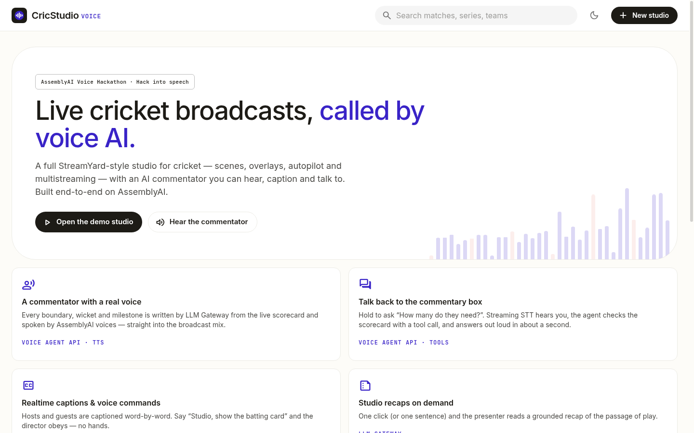
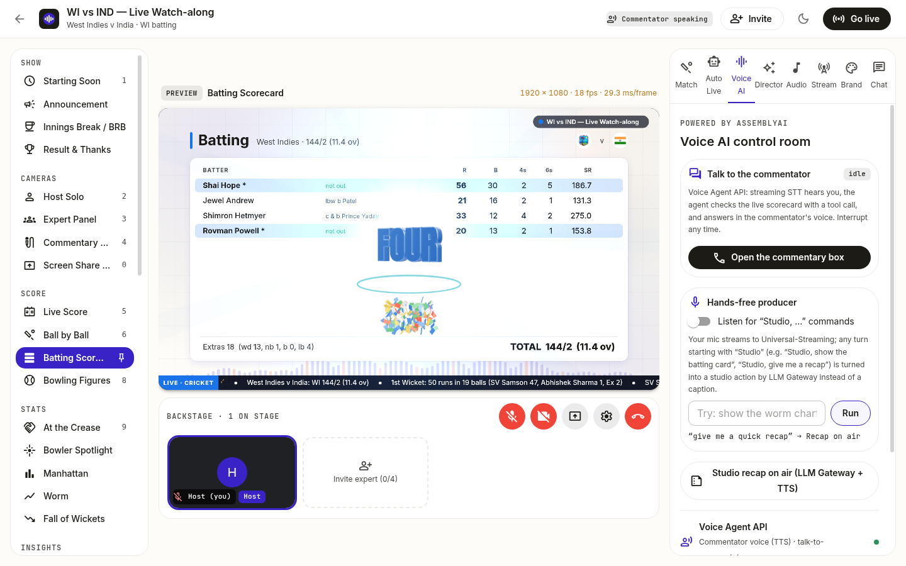

# CricStudio Voice 🏏🎙️ — a live cricket broadcast studio, voiced end-to-end by AssemblyAI

**Built for AssemblyAI's _Voice Hackathon: Hack into speech_ (Oct 2026).**

CricStudio Voice is the full [CricStudio](https://github.com/Yash-Kavaiya/cricstudio) broadcast studio — 40 scenes, compositor, overlays, autopilot, multistreaming to YouTube/Facebook/X/Twitch — rebuilt around **AssemblyAI** as its only voice and language stack. Every previous third-party AI integration (the old speech-to-text, TTS and LLM providers) has been removed and replaced with AssemblyAI products.

**Live:** https://cricstudio-voice.vercel.app



## The problem

Thousands of cricket matches every week — domestic first-class, women's leagues, associate nations — have a ball-by-ball feed but **no commentary, no captions and no broadcast**. Fans follow a silent scorecard, and blind or low-vision fans get nothing. CricStudio Voice turns any live match into a captioned, commentated show that you can **talk back to**.

## What AssemblyAI powers

| Feature | AssemblyAI product | Replaces | Code |
| --- | --- | --- | --- |
| **AI commentator voice** for every boundary, wicket, milestone and quiet spell — mixed into the broadcast | **Voice Agent API voices (TTS)**, 11 voices, word-for-word delivery | the old TTS provider | `apps/server/src/assemblyai/index.ts` → `speech()` |
| **Commentary writer** grounded in the live scorecard (in 13 languages) | **LLM Gateway** (`/v1/chat/completions`, model fallback) | the old LLM provider | `commentary/ai.ts` → `aaiCommentary()` |
| **Talk to the commentator** — hold to ask, the agent calls a `get_match_state` tool and answers out loud; barge-in supported | **Voice Agent API** (streaming STT + LLM + TTS, tool calling, single-use tokens) | — (new) | `apps/web/src/lib/voiceAgent.ts`, `VoiceAiPanel.tsx` |
| **Realtime live captions** for host + guests, burned into the stream, player names boosted | **Universal-Streaming v3** (`universal-streaming-english` / `-multilingual`, `keyterms_prompt`, formatted turns) | the old cloud STT providers | `apps/web/src/captions/aaiStreaming.ts` |
| **Hands-free producer** — say “Studio, show the batting card” / “Studio, give me a recap” | **Universal-Streaming** + **LLM Gateway** intent parsing | — (new) | `room.voiceCommand()` |
| **Studio recaps** read on air | **LLM Gateway** + **TTS** | — (new) | `room.recap()` |
| Translation of template lines into Hindi, Tamil, Bengali… | **LLM Gateway** | a free web translation endpoint | `commentary/translate.ts` |
| Key check / phrase transcription | **Async STT** (`/v2/upload` + `/v2/transcript`, Universal-3.5 Pro → Universal-2 fallback, keyterms) | the old cloud STT providers | `assemblyai/index.ts` → `transcribe()` |

The API key never reaches a browser: realtime captions and the voice agent use short-lived single-use tokens minted by the studio server. A studio can save its own AssemblyAI key (encrypted at rest), otherwise the server's `ASSEMBLYAI_API_KEY` is used. If AssemblyAI is unreachable the commentator falls back to templates and an offline voice, and captions fall back to browser speech — **the show never goes silent**.



## What's new on top of CricStudio

- **Voice AI tab** in the studio — talk-to-commentator, hands-free producer, recaps and a live status of every AssemblyAI product.
- **AssemblyAI-inspired UI** — warm paper background, ink text, cobalt accent, mono labels, pill buttons; a new **“AssemblyAI · Paper”** broadcast theme with a live voice-waveform background (default for new studios).
- **Latency readout** (question → first audio) in the talk-to-commentator panel.
- **`GET /api/aai/tts?text=…&voice=charles`** — AssemblyAI TTS as WAV (rate-limited), used by the landing page's *Hear the commentator* button.
- `GET /api/assemblyai/status` — whether the server key is configured.
- Older studios' AI settings are migrated to AssemblyAI automatically.

## Quick start

```bash
git clone https://github.com/Yash-Kavaiya/cricstudio-voice && cd cricstudio-voice
cp .env.example .env            # set ASSEMBLYAI_API_KEY
npm install
npm run dev                     # web http://localhost:5180 · server :8787
curl "http://localhost:8787/api/aai/tts?text=What%20a%20finish" -o finish.wav
```

Open the demo studio (a real T20I replay), go to **Auto Live** to turn on the commentator, and to **Voice AI** to talk to it.

## Deploy (Vercel)

`vercel.json` deploys the whole app — web UI, REST, Socket.IO and the optional FFmpeg/Chromium producer — as one **Vercel Container** from `Dockerfile.vercel`. Set **`ASSEMBLYAI_API_KEY`** (Production + Preview) in Project → Settings → Environment Variables and redeploy. RTMP streaming is disabled there (`STREAMING_DISABLED=1`); run the Docker image on a VM for 24/7 multistreaming.

## Using AssemblyAI's dashboard agent

The integration was built against the AssemblyAI docs (`llms.txt`). The AssemblyAI dashboard agent (assemblyai.com/dashboard/agent) needs a signed-in browser session and hasn't been used on this repo yet.

---

# Full studio reference (inherited from CricStudio)


## Quick start (no Docker needed)

```bash
# Node 22.13+ (uses built-in node:sqlite) and FFmpeg on PATH
npm install
npm run dev            # API :8787  ·  web http://localhost:5180
```

1. Open **http://localhost:5180**.
   - The dashboard lists every live, upcoming and finished match from ESPN.
   - A **Demo replay** card replays a real T20I ball by ball, so you can rehearse any time.
2. Click **Create studio** on a match and enter the green room. You are the host.
   - Pick your camera, microphone and background (Off, Slight blur or Blur) before joining.
   - In the studio, the ⚙ button opens **Settings**. The **Audio** tab switches mics and shows a level meter; the **Video** tab switches cameras and changes the background blur.
   - **Video effects:** Blur, **virtual background** (AI cut-out) or **green screen** (GPU chroma key with key colour, auto-detect, similarity, edge smoothness and spill controls). There are 6 built-in cricket backgrounds (Stadium night, Commentary box, Pitch view, Pavilion day, Broadcast studio, Scoreboard wall), or upload your own image. Brightness, contrast and saturation are adjustable.
   - **Voice chain** (Audio tab), applied before your mic goes on air: AI noise suppression, echo cancellation, auto gain, voice isolation, low-cut filter, noise gate, 4-band EQ, de-esser, compressor, character (warm or radio), room (commentary box, TV studio, stadium PA), output gain and a −1.5 dB limiter. "Hear yourself" lets you monitor in headphones. Cricket presets: Broadcast commentator, Natural, Radio commentary, Commentary box, Stadium announcer, Noisy ground, Warm podcast.
   - **Stadium crowd ambience** (Audio panel): a synthesised crowd bed with murmur, claps, "ooohs", fan horns and dhol drums, in three moods (Test match calm, ODI buzz, Packed T20).
   - Blur and virtual background run in your browser with MediaPipe's selfie segmenter. The model and wasm are self-hosted under `/models` and `/mediapipe`, so no CDN is needed. Guests and viewers see the blurred camera.
3. Click **Invite** and send the link to up to 4 guests.
   - Guests land backstage. You choose who goes on stage.
   - A 5th guest is refused.
4. Open **Stream → Add destination**, pick YouTube, Facebook, X, Twitch or custom RTMP, and paste the stream key.
5. Click **Go live**.

Production: `npm run build && npm start` serves the UI and API on one port (`:8787`) as plain Node.

### Going 24/7 in the cloud

1. `docker compose up -d`. The image ships FFmpeg and Chromium. Put `STREAM_KEY_SECRET` in `.env`.
2. Open the studio, add your destinations, then go to **Auto Live** and switch on **Auto-pick live matches**.
3. Click **Start 24/7 cloud stream**. You can now close the browser.

From there:
- The server renders the show in headless Chrome and streams it.
- It follows the best live match, and plays a replay when nothing is live.
- It resumes automatically after deploys and reboots.

---

## What's inside

### 40 scenes (hotkeys `1`–`0`)

| Group | Scenes |
|---|---|
| Show | Starting Soon (countdown, music visualiser) · Innings Break / BRB · Result & Thanks (confetti, top performers) |
| Cameras | Host Solo · Expert Panel (1–5 tiles, spotlight) · Commentary Desk (cams + live feed) · Screen Share + PiP |
| Score | Live Score hero (CRR/RRR, chase bar) · Ball by Ball (this over + last 4 overs + commentary) · Batting Scorecard · Bowling Figures |
| Stats | At the Crease (partnership) · Bowler Spotlight · Manhattan · Worm · Fall of Wickets |
| Insights | Win Predictor · Projected Score · Phase Analysis (powerplay/middle/death) · Boundary Tracker · Batter vs Bowler · Wagon Wheel · Star Performer · Key Moments |
| Analysis | Run Rate Graph (both innings + required rate) · Over-by-Over Heatmap · Scoring Breakdown (run sources, dot %, balls per boundary) · Partnerships · Batting Impact (balls vs strike rate bubbles) · Bowling Analysis (economy vs team, dot %) · How Wickets Fell · Extras & Discipline · Momentum Swing (gauge) · At This Stage (chase vs 1st innings) · Chase Calculator (what-if scenarios, boundary maths, win chance) · Match Report |
| Match | Playing XIs & Toss · Around the Grounds (every live match, paged) · Upcoming Matches · Fan Poll |

**Looks:**
- **11 animated backgrounds:** Stadium Night (floodlights + crowd bokeh), Pitch Green, Aurora, Neon Grid 3D, Constellation, Hex Tech, Liquid Waves, Prism Glass, Team Clash (team colours), Ball Seam, Classic.
- **10 transitions:** fade-zoom, slide, diagonal wipe, circle reveal, blinds, 3D flip, push, cricket-ball stinger, glitch, zoom-blur. **Mixed** mode varies them on every cut.

**3D celebrations** (three.js, WebGL, with a 2D fallback):
- Extruded metallic **FOUR / SIX / WICKET! / FIFTY / CENTURY / 5 WICKETS** text.
- A spinning seamed cricket ball with a motion trail.
- **Stumps exploding**, with bails cartwheeling away.
- Fireworks, 3D confetti, shockwave rings, light flashes and camera shake.
- Every effect cleans up after itself, so 24/7 runs don't leak memory.

**Always-on layers:**
- Scorebug on camera scenes, showing the chase equation, batters, bowler and this over's balls.
- A scrolling ticker with your message, match notes and other live scores.
- A brand bug with a LIVE pulse.
- Burned-in live captions.

**Event overlays**, each with its own synthesized sound:

| Overlay | Sound | Notes |
|---|---|---|
| FOUR | Boundary horn | Light rays and particles |
| SIX | Fanfare | Particles |
| WICKET | Stumps and sting | Screen shake |
| 50 / 100 / 5-for | Brass fanfare | — |
| Partnership | Applause | — |
| Hat-trick watch | Drum roll | — |
| Over summary | Chime | — |
| Innings / match end | — | — |

Every scene change cross-fades with a gentle zoom and a whoosh.

### Auto Live mode (no host needed)

| Setting | What it does |
|---|---|
| Scene duration (3–30 s, default 8) | Rotates through data scenes with a different transition each cut. Wickets, boundaries and milestones still interrupt instantly. |
| Include camera scenes | Off = a pure scoreboard show with no host camera. On = host and guest cameras join the rotation when someone is on stage. |
| Auto music bed | Rotates the royalty-free tracks every 4 minutes, plays tea-break music in innings breaks and a victory track on the result, and ducks under speech. |
| AI commentator | Free neural voices (8 accents: India, UK, Australia, US, SA). Reacts to every big moment with varied, human-style lines, and fills quiet spells with context: the chase equation, partnership, bowler figures, projected score, other games, polls and calls to action. The voice is mixed into the stream and shown as captions. You can also type a line for it to say. |
| Auto-pick live matches | For 24/7. Follows the best live match (international > big leagues > others) and moves on 10 minutes after a result. |

### Never-break streaming

```
producer (host browser or cloud headless Chrome)
   └─ WebM (H.264 + Opus) ─► encoder: video passthrough, audio → AAC, continuous timestamps ─► MPEG-TS
                                     ├─► relay ─► YouTube    (each relay reconnects independently,
                                     ├─► relay ─► Facebook    exponential backoff, bounded buffers)
                                     ├─► relay ─► X
                                     └─► relay ─► Twitch
```

- **Producer or encoder restart**: the relays keep their RTMP connections open. Viewers see a short freeze, not an ended stream. Verified by killing the producer mid-stream: same connection, 0 retries.
- **Socket blips**: the browser queues up to ~10 s of program and flushes it in order on reconnect. If the gap is longer, it restarts cleanly with a fresh header.
- **Host's browser dies while live**: the cloud producer takes over after 8 s (`HOST_FAILOVER_MS`).
- **Server restart, deploy or reboot**: studios marked live resume automatically.
- **Watchdog**: restarts the producer on a crash, missing heartbeat, or heap above `WORKER_MAX_HEAP_MB`, and recycles it every `WORKER_RECYCLE_HOURS`.
- **Memory**: no local recording. Caches (images, TTS, ball history, chat, logs) are all bounded. H.264 passthrough cuts encoder CPU by about 90%.

### Automation (the director)

The poller compares each new delivery with the last one it saw and emits:
`BALL`, `FOUR`, `SIX`, `WICKET`, `WIDE`, `NOBALL`, `OVER_END`, `INNINGS_END`, `MATCH_END`, `MILESTONE_BAT`, `MILESTONE_BOWL`, `PARTNERSHIP` and `HATTRICK_WATCH`.

| Event | What goes on air |
|---|---|
| Wicket | WICKET overlay + stumps sting → batting card for 11s → back to your scene |
| Boundary | FOUR/SIX celebration with crowd and horn |
| End of over | Over summary → ball-by-ball (Manhattan every 5th over) |
| 50 / 100 / 5-for | Milestone banner → batters / bowler spotlight |
| Innings break / result | Switches to the Break / Result scene |
| Nothing happening | Rotates through stats scenes briefly, then back to cameras |

**Modes:**
- **Auto**: everything above happens on its own.
- **Assist**: one-click suggestions.
- **Manual**: nothing is automatic.

A manual cut pins your scene for 30s, and overlays have priorities and a queue. **Fire a moment** buttons let you trigger any event for rehearsals.

### Audio — 100% royalty-free music, AssemblyAI commentator voice

- **Music**: 6 original tracks generated live in the browser with a WebAudio sequencer:
  - Stadium Anthem, Powerplay Pulse, Chill Pitch, Tea Break Lo-fi, DRS Tension, Victory Lap.
  - Nothing is sampled or licensed, so nothing can trigger a Content ID claim.
- **Uploads**: you can also upload your own tracks, e.g. from Pixabay or the YouTube Audio Library.
- **Sound effects**: 11 synthesized cricket sounds — bat crack, crowd roar, applause, stumps and so on.
- **Mixer**:
  - Music ducks automatically when anyone speaks.
  - A glue compressor plus a limiter keeps the stream under 0 dBFS.
  - A separate headphone monitor level for the host.

### Live data — ESPN (free, no key)

| Endpoint | Used for |
|---|---|
| `site.web.api.espn.com/apis/site/v2/sports/cricket/scorepanel` | all current matches |
| `…/cricket/{league}/summary?event={id}` | scorecards, squads, toss, venue, notes |
| `site.api.espn.com/…/cricket/{league}/playbyplay?event={id}&page=N` | ball-by-ball (25 per page) |

`BallStore` mirrors play-by-play incrementally:
- The first sync loads the latest 14 pages.
- After that, each tick fetches only the last page plus any new ones, about one request every 6s per live match.

There is one poller per match no matter how many studios watch it.

---

## Architecture

```
┌──────────── Browser (host) ─────────────┐        ┌────────────── Server (Node) ──────────────┐
│ React + MUI studio UI (AssemblyAI style)│        │ Fastify REST  ·  Socket.IO (state, signaling)│
│ MeshRTC ⇄ guests (P2P, ≤5 + program)    │◄─────►│ StudioRoom: authoritative scene/overlay state│
│ ProgramRenderer → 1920×1080 canvas 30fps│ ws     │ AutomationEngine (rules, queue, pins)        │
│ AudioEngine: voices+music+sfx → mix     │        │ MatchHub → ESPN pollers → EventDetector     │
│ MediaRecorder(WebM) ─────────────────── chunks ─►│ MultiStreamer: FFmpeg x264/AAC → tee ──┬► YouTube
└─────────────────────────────────────────┘        │ Repo: SQLite | Postgres (AES-GCM keys)  ├► Facebook
                                                   │ Bus: memory | Redis (lock + pub/sub)    ├► X
   Guests (≤4): same UI, receive program state      └─────────────────────────────────────────┴► Twitch
```

- `packages/shared`: typed contract (scenes, studio state, events, platform presets).
- `packages/cricket-engine`: ESPN client, normalizer, `BallStore`, `EventDetector`. Pure code with unit tests against recorded real fixtures.
- `apps/server`: API, sockets, automation, FFmpeg multistream, LiveKit adapter, storage.
- `apps/web`: dashboard, studio, guest join, `/program/:id` clean feed, compositor, audio, WebRTC.

### Two media modes

| | `MEDIA_MODE=mesh` (default) | `MEDIA_MODE=livekit` |
|---|---|---|
| Calls | Peer-to-peer WebRTC full mesh (fine for 5) | LiveKit SFU |
| Compositing | Host browser canvas | LiveKit **Web Egress** renders `/program/:id` in headless Chrome |
| Encode/fan-out | Server FFmpeg, one x264 encode → `tee` → N RTMP (`onfail=ignore`) | Egress pushes to all RTMP URLs |
| Needs | Node + FFmpeg | Docker/Kubernetes or LiveKit Cloud |
| Host can close tab while live | ✗ | ✓ |

`/program/:id?k=<programToken>` is also a ready-made **OBS / vMix browser source**. Copy it from the Invite dialog.

### Scaling

- **Stateless API nodes behind a load balancer.**
  - Set `REDIS_URL` to enable:
    - the Socket.IO Redis adapter;
    - Redis pub/sub for match updates;
    - a Redis lock so only one node polls ESPN per match.
  - Route a studio's sockets to the same node (sticky by `/studio/:id`, or by cookie), since live studio state is in memory.
- **Postgres** (`DATABASE_URL`) for studios and encrypted stream keys. SQLite is the zero-config default.
- **Encoders.** Each live studio is one FFmpeg process (~1 vCPU at 1080p30 `veryfast`). Scale nodes by concurrent live shows, or move compositing and encoding to LiveKit egress workers, which scale independently.
- **TURN.** Set `TURN_URL` etc. for guests on strict NATs.

```bash
docker compose up -d                                   # app + redis + postgres
MEDIA_MODE=livekit docker compose --profile livekit up -d   # + LiveKit SFU + egress
```

### Security

- Host, guest and program links use separate random tokens. Only SHA-256 hashes are stored.
- Host-only socket actions are enforced on the server.
- Stream keys are encrypted with AES-256-GCM (`STREAM_KEY_SECRET`) and are never sent back to the browser (masked only).
- Uploads accept audio files only, up to 40 MB.

---

## Platform setup cheatsheet

| Platform | Where to get URL + key | Preset URL |
|---|---|---|
| YouTube | YouTube Studio → Go live → Stream | `rtmp://a.rtmp.youtube.com/live2` |
| Facebook | Live Producer → Streaming software | `rtmps://live-api-s.facebook.com:443/rtmp/` |
| X | Media Studio → Producer → Sources (needs Producer access) | region-specific `rtmps://…pscp.tv:443/x` |
| Twitch | Creator Dashboard → Settings → Stream | `rtmp://live.twitch.tv/app` |

## Tests

```bash
npm test         # cricket-engine (ESPN fixtures, detector, BallStore) + server (ffmpeg args, crypto, automation)
npm run build    # strict typecheck of all workspaces + production web build
```

Verified end to end on this machine:
- **Live data**: a real ESPN live match drives the scenes.
- **WebRTC**: host, guest and program feed connect over mesh WebRTC.
- **Speaker cap**: a 5th guest is rejected.
- **Multistream**: a 1080p30 H.264 + AAC stream reached two local RTMP sinks plus an MKV recording at the same time (audio around −17 dB mean, peaks below −1 dB).

## Notes / limits

- ESPN's endpoints are public but undocumented. Responses are cached and polling is adaptive. If ESPN changes shape, update `packages/cricket-engine/src/normalize.ts`; the fixtures make that easy to test.
- In mesh mode the host's browser does the compositing. Use a wired connection with about 6 Mbps upload, and keep the tab open.
- Live captions use the browser Web Speech API (Chrome/Edge).
