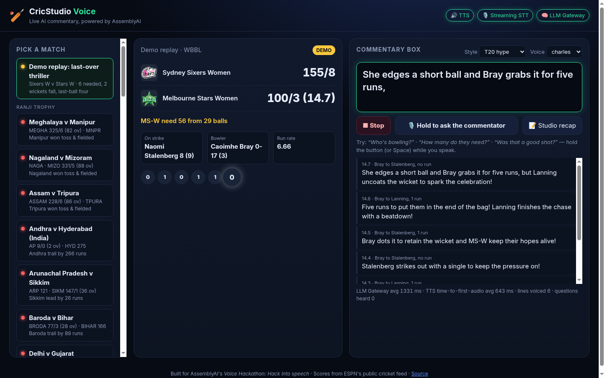

# 🏏 CricStudio Voice

**Live AI cricket commentary you can talk back to — voiced, heard and written entirely by AssemblyAI.**

Built for AssemblyAI's *Voice Hackathon: Hack into speech* (Oct 2026). A voice-first spin-off of [CricStudio](https://github.com/Yash-Kavaiya/cricstudio), the multistream cricket broadcast studio. The original used Gnani for the commentator voice and Google Gemini for the script; this version swaps the whole voice + language stack for AssemblyAI and runs as a serverless web app — no RTMP server, no ffmpeg, no GPU.

**Live demo:** https://cricstudio-voice.vercel.app



---

## The problem

Hundreds of cricket matches every week (domestic first-class, women's leagues, associate nations) have a live ball-by-ball feed but **no commentary at all**. Fans follow a silent scorecard. Blind and low-vision fans — and anyone driving, cooking or working — get nothing.

## What it does

1. **Pick any live match** (pulled from ESPN's public cricket feed) — or the built-in **demo replay**: the last three overs of a real WBBL thriller (Stars need runs, two wickets in the final over, four off the last ball to win).
2. **Press Start.** Every new ball is turned into a one-line, broadcast-style call by **AssemblyAI LLM Gateway**, then spoken by the commentator **"Ravi"** through **AssemblyAI text-to-speech**, with word-by-word captions synced to the audio (word timestamps).
3. **Hold the mic button and ask anything** — *"How many do they need?"*, *"Who's bowling?"*, *"Was that a good shot?"*. AssemblyAI's **streaming speech-to-text** hears you (with player names boosted as key terms), the agent calls a `get_match_state` tool for live facts, and answers out loud. You can barge in mid-sentence; the commentator stops and listens.
4. **Studio recap** — an LLM Gateway summary of the passage of play, read by the studio voice.
5. Pick a commentary **style** (T20 hype · Classic · Analyst · Desi flavour) and one of 11 English **voices**.

## AssemblyAI APIs used

| Feature | AssemblyAI API | Where |
| --- | --- | --- |
| Commentator voice (TTS), word-level caption timing | **Voice Agent API** (`wss://agents.assemblyai.com/v1/ws`, `reply.create`, `reply.audio`, `transcript.agent.delta`) | `public/app.js` |
| "Talk to the commentator" speech recognition, turn detection, barge-in, key-term boosting | **Voice Agent API streaming STT** (`input.audio`, `transcript.user.delta`, `input.keyterms`) | `public/app.js`, `public/mic-worklet.js` |
| Live facts while answering | **Voice Agent tool calling** (`tool.call` → `tool.result`) | `public/app.js` |
| Writing every commentary line + studio recap | **LLM Gateway** (`https://llm-gateway.assemblyai.com/v1/chat/completions`, model fallback chain) | `api/commentary.js`, `api/recap.js` |
| Secure browser auth | **Temporary tokens** (`GET /v1/token`, single-use) | `api/voice-token.js` |
| Server-side TTS endpoint (`/api/tts?text=…` → WAV) | Voice Agent API from Node | `api/tts.js` |

> AssemblyAI's standalone TTS-1 endpoint is in early access; today its production TTS voices ship through the Voice Agent API, which is what this app uses. `synthesize()` in `api/_lib.js` is the single place to swap in the standalone endpoint once it's public.

## Architecture

```
            ESPN public cricket feed (scorepanel + ball-by-ball)
                               │  poll every 12 s
                               ▼
 ┌──────────── Vercel serverless (api/*.js) ─────────────┐
 │ /api/matches  /api/match   → normalised score + balls │
 │ /api/commentary /api/recap → AssemblyAI LLM Gateway   │
 │ /api/voice-token           → AssemblyAI temp token    │
 │ /api/tts                   → AssemblyAI TTS → WAV      │
 └───────────────────────────────────────────────────────┘
                               │
                               ▼
 Browser (public/)  ──── single WebSocket ────►  AssemblyAI Voice Agent API
   scorecard, ticker,        reply.create "SAY VERBATIM: <line>"   → TTS audio + word timings
   captions, push-to-talk    input.audio (24 kHz PCM16 mic)        → streaming STT → LLM → TTS
                             tool.call get_match_state ◄──► tool.result (live scorecard JSON)
```

The API key never reaches the browser: the client gets a single-use token that opens exactly one Voice Agent session.

No framework, no build step: static HTML/CSS/JS + Node 22 serverless functions with zero dependencies.

## Run it locally

```bash
git clone https://github.com/Yash-Kavaiya/cricstudio-voice && cd cricstudio-voice
export ASSEMBLYAI_API_KEY=your_key      # see .env.example
npm run dev                              # http://localhost:3000
curl "http://localhost:3000/api/tts?text=What%20a%20finish&voice=charles" -o finish.wav
```

## Deploy to Vercel

```bash
vercel --prod   # then add ASSEMBLYAI_API_KEY in Project → Settings → Environment Variables
```

Optional: `COMMENTARY_MODEL` picks any LLM Gateway model your account can use (falls back to `qwen3.5-4b-32k-fast`). Refresh the demo replay from any finished match with `npm run sample -- <leagueId> <eventId>`.

## Relationship to CricStudio

CricStudio (the parent repo) is a full broadcast studio that renders scenes in headless Chrome and pushes RTMP to YouTube/X. Those server-only pieces stay in that repo. CricStudio Voice is the lightweight, voice-first front end — no Gnani, no Google APIs — and its `/api/tts` endpoint can feed the studio's commentary audio track.

## License

MIT
